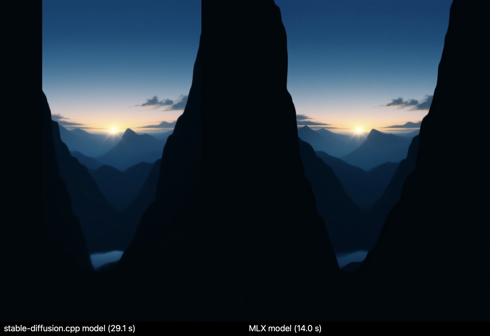
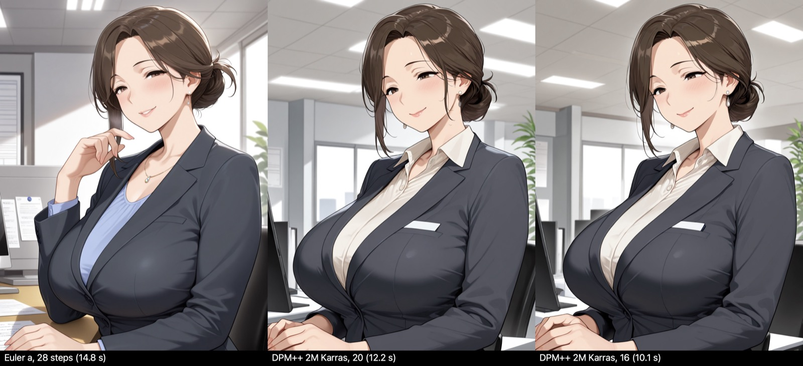

# Performance notes

What makes WAI Gen fast, what was measured, and what was tried and dropped. All numbers are from one
Apple M5 Max (128 GB), Release builds, unless noted. "Warm" = models already loaded.

## Where the time goes (current)

| Job | Time | Biggest part |
|---|---|---|
| WAI v16, 1024×1344, 28 steps | ~15-17 s | UNet sampling, ~0.6 s/step (MLX) |
| WAI v16 face repair (one face) | ~6 s (was 17.3 s) | 11 masked steps at 1024×1024 (MLX) |
| WAI-ANIMA, 1024×1344 → 1536×2016 hi-res + face repair, cold start | **157 s** (346 s this morning, 750 s originally) | the Anima model, now in MLX: 1.36 s/step at 1024×1344 |

## Round 1: engines (2026-11-19)

### SDXL (WAI-illustrious) in MLX instead of ComfyUI / stable-diffusion.cpp

WAI v16, 832×1216, 28 steps:

| Engine | Time |
|---|---|
| **MLX (WaiMLX, this app)** | **~12 s** |
| ComfyUI (PyTorch MPS) | 15.6 s |
| stable-diffusion.cpp (Metal) | 37.7 s |

The SDXL code is Apple's mlx-swift-examples StableDiffusion, with ComfyUI-style k-diffusion sampling, prompt
weighting and single-file checkpoint loading added. The cond/uncond passes run as one batch of 2, attention
is MLX's fused `scaledDotProductAttention`, and MLX 0.31 uses the M5's neural accelerators for matrix math.

The one fix that mattered: the VAE's middle attention originally built the full [HW × HW] score matrix
(~5 GB at 1248×1824), which pushed the second generation into swap (137 s). Fused attention, a bf16 VAE and
`Memory.cacheLimit = 2 GB` brought VAE decode from 7.6 s to 0.6 s and made repeated runs stable.

### WAI-ANIMA's VAE in MLX (`QwenImageVAE.swift`, `patches/stable-diffusion.cpp.patch`)

stable-diffusion.cpp runs the Qwen-Image (Wan 2.1) VAE through ggml's 3D convolutions, which are very slow on
Metal at these sizes:

| | stable-diffusion.cpp | MLX |
|---|---|---|
| decode 1024×1344 | ~45 s | **0.27 s** |
| decode 1536×2016 | ~135 s | **0.68 s** |
| encode 1536×2016 | ~85 s | **0.59 s** |

- For one frame the causal 3D VAE is exactly a 2D VAE (only the last temporal slice of each 3×3×3 kernel sees
  the image; `time_conv` is skipped on the first frame), so it runs as a plain 2D network.
- A 61-line patch adds `sd_set_vae_hook()` to stable-diffusion.cpp: every single-image VAE encode/decode of a
  context (txt2img, img2img, hi-res, face repair) goes to the app. The latent mean/std normalisation stays
  in stable-diffusion.cpp.
- Checked: encode → decode round trip 44.5-45 dB PSNR; a full txt2img where only the VAE differs is 53.9 dB
  from stable-diffusion.cpp's image; img2img 38.6 dB (one sampling step amplifies tiny differences).
- **Tried and dropped:** stable-diffusion.cpp's `vae_tiling` (154 tiles × 3.3 s, far slower) and
  `vae_conv_direct` (281 s vs 250 s for a 1-step img2img at 1536×2016).

### ESRGAN upscaler in MLX (`RealESRGAN.swift`, `TorchCheckpoint.swift`)

RealESRGAN_x4plus_anime_6B, 1024×1344 → 4096×5376: **1.97 s** in MLX vs 27.5 s in stable-diffusion.cpp
(60.6 dB PSNR between the two). This is the "upscaling" step of every hi-res image. `.pth` files are read by a
loader that implements only the pickle opcodes of a tensor `state_dict` and refuses any other callable (a
booby-trapped file calling `os.system` is rejected and nothing runs).

For WAI-ANIMA the app now runs the hi-res fix itself (base pass → MLX ESRGAN → img2img at the new size) instead
of stable-diffusion.cpp's built-in hi-res, so the upscaler and both VAE passes run in MLX.

**WAI-ANIMA, 1024×1344 → 1536×2016 with hi-res and face repair: 750 s → 346 s; face repair 110 s → 27 s.**

### Keeping models loaded

- The selected image model, the upscaler and the face-repair helpers load in the background when the app
  opens and when another model is picked, so the first image doesn't wait. Loading always yields to a waiting
  generation (each load step is queued behind it).
- They are freed after 5 minutes without generating (configurable) and reload on return.
- Optional: keep every image model loaded for instant switching. Measured footprint with WAI v16, v12 and
  WAI-ANIMA plus face repair loaded: **14 GB** (`footprint`).
- A cold WAI v16 start was only ~3.5 s slower than a warm one (macOS keeps the file cached), so converting
  checkpoints to a faster-loading format isn't worth it.

### Not speed, but found while measuring

Quitting after stable-diffusion.cpp had been used always crashed ("quit unexpectedly"): ggml's Metal backend
asserts in a C++ static destructor at `exit()` that every GPU buffer was freed. The app now frees all models
on `willTerminate`; the CLI leaves through `_exit`.

## Round 2 (2026-11-19 evening)

Ordered by effort: trivial and small changes first, then medium, then large.

### Trivial: 15 hi-res steps instead of 20 (all presets)

- WAI v16, same seed, 1024×1344 → 1536×2016, denoise 0.4: 20, 15 and 12 hi-res steps look the same at full size
  (12 loses a little texture in hair highlights). About 8 s saved per hi-res image.

  
- WAI-ANIMA, same seed, 1.5× of a 1024×1344 image: 20 and 15 steps are indistinguishable; **214.7 s → 174.9 s**.

  
- All presets now use 15; saved settings that still had the old default 20 are migrated once.

### Small changes

| Change | Measured | Kept? |
|---|---|---|
| `MLX.compile` on the UNet call (model passed as state, so LoRA updates are seen) | UNet step 0.628 → 0.609 s (batch 1), 0.571 → 0.538 s (batch 2) at 1024×1344; full image 17.23 → 16.95 s; **bit-identical output** | **yes** |
| WAI-ANIMA weights as `q8_0` (stable-diffusion.cpp `wtype`) | 2.72 → 2.65 s/step (−2.6 %), same 29 s total for 10 steps, output 30.8 dB from the original | no |
| Caching the text encoding between images | the MLX text encode takes 0.04 s | no (nothing to gain) |
| Generating "Images: 2" as one batch | UNet 0.609 → 0.538 s per image per step (−12 %), only for multi-image runs | not yet (would touch every stage: hi-res, face repair, previews) |

Notes:
- stable-diffusion.cpp's fast INT8 path (Metal "TensorOps", the M5's int8 units) is only used for ComfyUI-style
  pre-quantised `int8_tensorwise` safetensors, not for `wtype=q8_0`. Converting WAI-ANIMA to that format wasn't
  pursued because the large step below replaces stable-diffusion.cpp for WAI-ANIMA anyway.
- The benchmark lives in the CLI: `waigen-cli -m <checkpoint> -p x --bench-unet 1024x1344`.

### Medium: face repair for WAI v16 / v12 in MLX

Face repair used a second stable-diffusion.cpp context with the same SDXL checkpoint (~7 GB, ~20 s to load)
and took **17.3 s** warm per image with one face, longer than generating the image (16.4 s).

Now stable-diffusion.cpp only runs the YOLOv8 face detector (new `sd_adetailer_detect()` in
`patches/stable-diffusion.cpp.patch`, ~0.15-0.35 s), and the MLX engine that made the image repaints the faces.
`FaceRepair.swift` ports stable-diffusion.cpp's detailer step by step so the result matches:

- box → `dilate 4` (−1/+2 px) → 32 px padding → square crop around the centre → bilinear resize to 1024×1024;
- masked img2img at strength 0.4: the last `steps × strength` steps of the job's schedule, and after every step
  the prediction outside the mask is replaced by the original latent (`denoised·m + init·(1−m)`, mask
  downsampled nearest-max to latent size), exactly like stable-diffusion.cpp's denoise mask;
- paste back through a Gaussian-feathered mask (σ = 4, radius 10, edges clamped), bilinear resampling at
  half-pixel centres, as `composite_crop` does.

**17.3 s → 6.0 s per image with a face** (detection included), visually equivalent results, and no second copy of the checkpoint in memory.

WAI-ANIMA keeps stable-diffusion.cpp's
own ADetailer (its repaint already uses the MLX VAE).

### Large: WAI-ANIMA's diffusion model in MLX (`AnimaDiT.swift`)

The Anima model (a Cosmos-Predict2-style DiT: 28 blocks, 2048 wide, 16 heads, plus a 6-block LLM adapter that
turns Qwen3-0.6B states into the context) is ported line by line from stable-diffusion.cpp's `anima.hpp`:
padding-mask channel and 2×2 patchify, `[cos | sin]` timestep embedding, AdaLN-Zero modulation
(`LN(x)·(1+scale)+shift`, gates), per-head RMS-normed q/k, rotate-half RoPE over (0, row, col) with 44/42/42
dims and NTK-scaled θ for rows and columns, tanh-GELU MLPs, `(ph pw c)` unpatchify.

stable-diffusion.cpp still does everything around it: Qwen3 text encoding, the sampler and CFG, the progress
and preview callbacks, face repair. The patch adds `sd_set_diffusion_hook()`: when set, Anima's forward pass
calls the app with the latent, timestep, text states and adapter tokens instead of running its ggml graph
(jobs with WAI-ANIMA LoRAs switch the hook off, because the LoRAs are applied inside stable-diffusion.cpp's model).
stable-diffusion.cpp loads weights lazily, so with the hook it never loads its own copy of the model.

| WAI-ANIMA, 1024×1344, 10 steps, same seed | stable-diffusion.cpp model | MLX model |
|---|---|---|
| per step | 2.72 s | **1.36 s** |
| total | 29.1 s | **14.0 s** |

The two images agree to 32.3 dB PSNR (bf16 rounding over 28 blocks × 10 steps; a wrong port gives ~10 dB)
and look the same:

**In the app**, WAI-ANIMA 1024×1344 → 1536×2016 with hi-res (15 steps, MLX ESRGAN) and face repair, including
the cold model load: **156.8 s** (face repair 22.4 s), memory footprint 6.7 GB. The same job was 346 s this
morning and 750 s before the VAE port.

## Round 3 (2026-11-20)

Same order: trivial, small, medium. Everything measured; what didn't pay off was dropped.

### Trivial: Fast mode (opt-in)

A sampler that converges in fewer steps, as a switch in the inspector (off by default, because the picture
changes: Euler a re-injects noise every step, the fast samplers don't). Same seed, 1024×1344:

| Model | Normal | Fast | Look |
|---|---|---|---|
| WAI v16 | Euler a, 28 steps: 14.8 s | **DPM++ 2M Karras, 16 steps: 10.1 s (−32 %)** | clean; 16 steps as good as 20 |
| WAI-ANIMA | Euler a, 25 steps: 35.4 s | **Euler, 16 steps: 25.4 s (−28 %)** | clean; DPM++ 2M at 16 steps left blotchy texture on this flow model |

### Small changes

| Change | Measured | Kept? |
|---|---|---|
| Caching the LLM adapter output across steps (WAI-ANIMA) | the adapter is 4.5 ms of a ~700 ms forward pass (0.6 %) | no |
| `MLX.compile` on the MLX Anima forward pass | −3.5 % per pass once traced (0.704 → 0.679 s), but cond and uncond have different text lengths, so every image traces it twice (and again for hi-res): a 10-step image went 13.1 → 13.8 s. Bit-identical output | opt-in only (`WAIGEN_COMPILE=1`) |
| Quantized Anima linears in MLX | bf16 0.784 s per pass; 8-bit affine 0.812 s; mxfp8 0.883 s; 4-bit 0.784 s (and lower quality). With 5 376 image tokens the GEMMs are compute-bound, bf16 is the fast path | no |

### Medium

| Change | Measured | Kept? |
|---|---|---|
| Both CFG passes of a WAI-ANIMA step in one MLX call (needs another sd.cpp patch) | batch 2 vs batch 1 per sample: 0.752/0.737 s vs 0.787/0.708 s, no consistent gain: the GPU is already saturated at batch 1 | no |
| **LoRAs on the MLX Anima model** | see below | **yes** |
| "Images: 2+" as one batch (WAI v16/v12) | −12 % on the base pass only; with hi-res and face repair (where most of the time goes) about 2-5 % per image, for multi-image runs only, while every stage (hi-res, face repair, previews, per-seed noise) would need batching | no |

**LoRAs on the MLX Anima model.** WAI-ANIMA jobs with LoRAs used to fall back to stable-diffusion.cpp's model
(2.7 s/step). `AnimaDiT.setLoRAs` now merges them into the MLX weights (`W += strength · alpha/rank · up·down`, the
originals kept to undo it) with the key formats stable-diffusion.cpp accepts (kohya `lora_down/lora_up/alpha`, PEFT
`lora_A/lora_B`, `lora_unet_` underscores, `diffusion_model.`/`transformer.`/`net.` prefixes). A LoRA it can't fully
map (LoHa, LoKr) still goes to stable-diffusion.cpp's model. Checked with a synthetic rank-8 LoRA on 36 layers,
same seed, 10 steps:

- MLX vs stable-diffusion.cpp, both with the LoRA: **37.6 dB** (they agree);
- MLX with vs without the LoRA: 21.4 dB (the LoRA really changes the image);
- 14.6 s vs 25.6 s for the image (1.49 vs 2.45 s/step).

The SDXL path was also checked with a real character LoRA (kohya, rank 32, text encoders + UNet): 1 056 layers
applied, 0 unmatched, and the MLX face repair keeps the LoRA.

## Possible next steps

- The Qwen3 text encoder of WAI-ANIMA and the face detector still run in stable-diffusion.cpp; both take well under
  a second, so there is little left to gain there.
- What remains is mostly the models' own compute. Fewer steps (Fast mode) is the remaining big lever.
