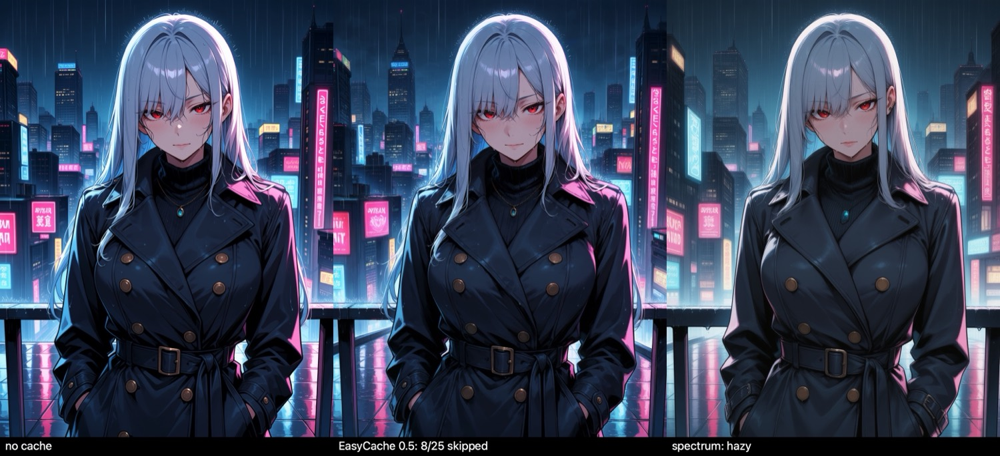
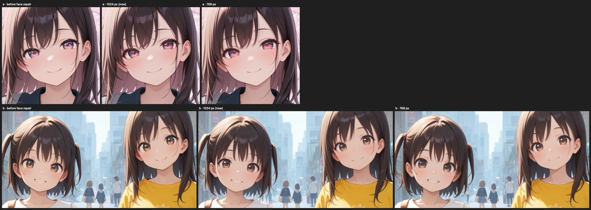
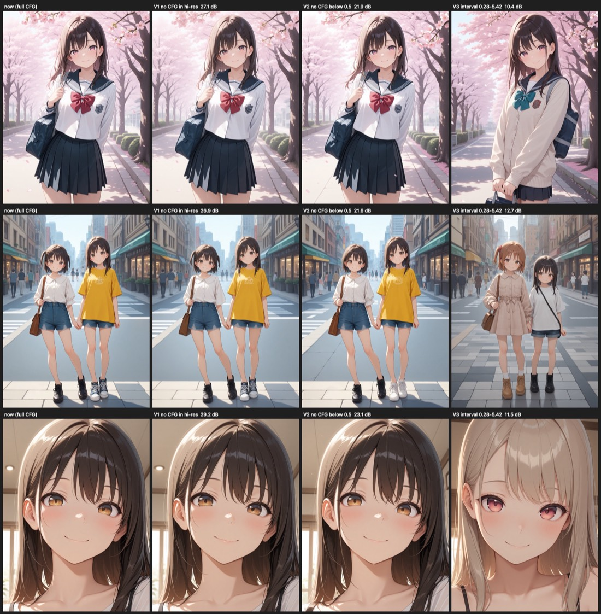
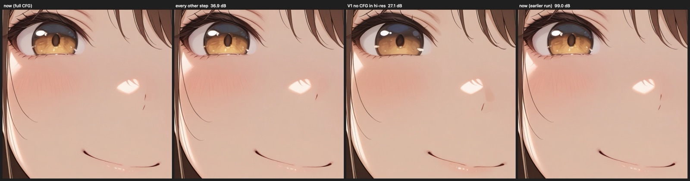
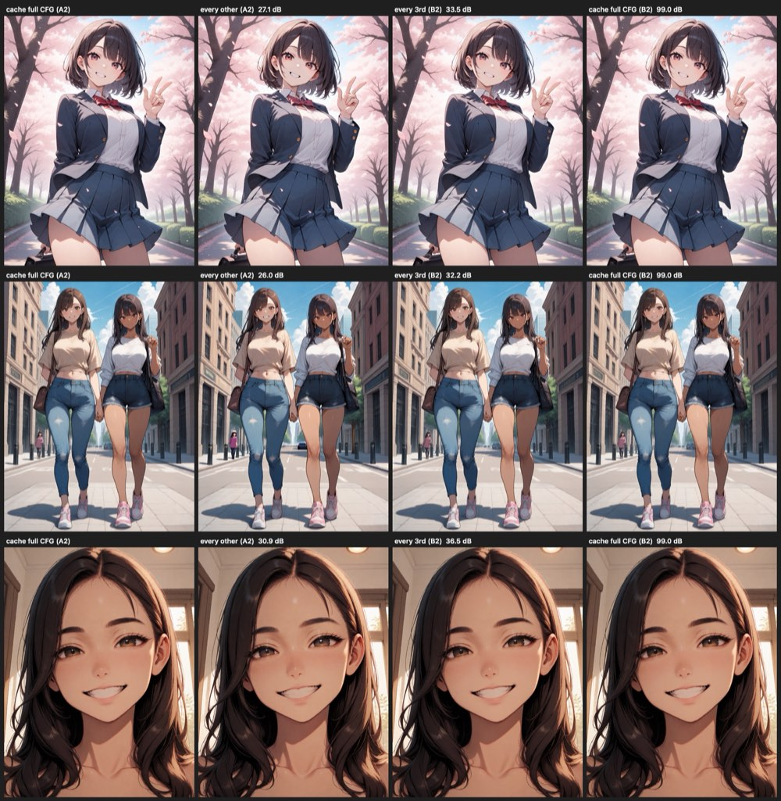
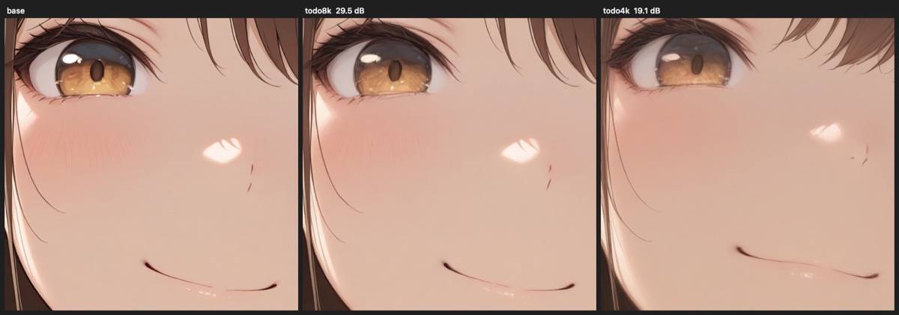
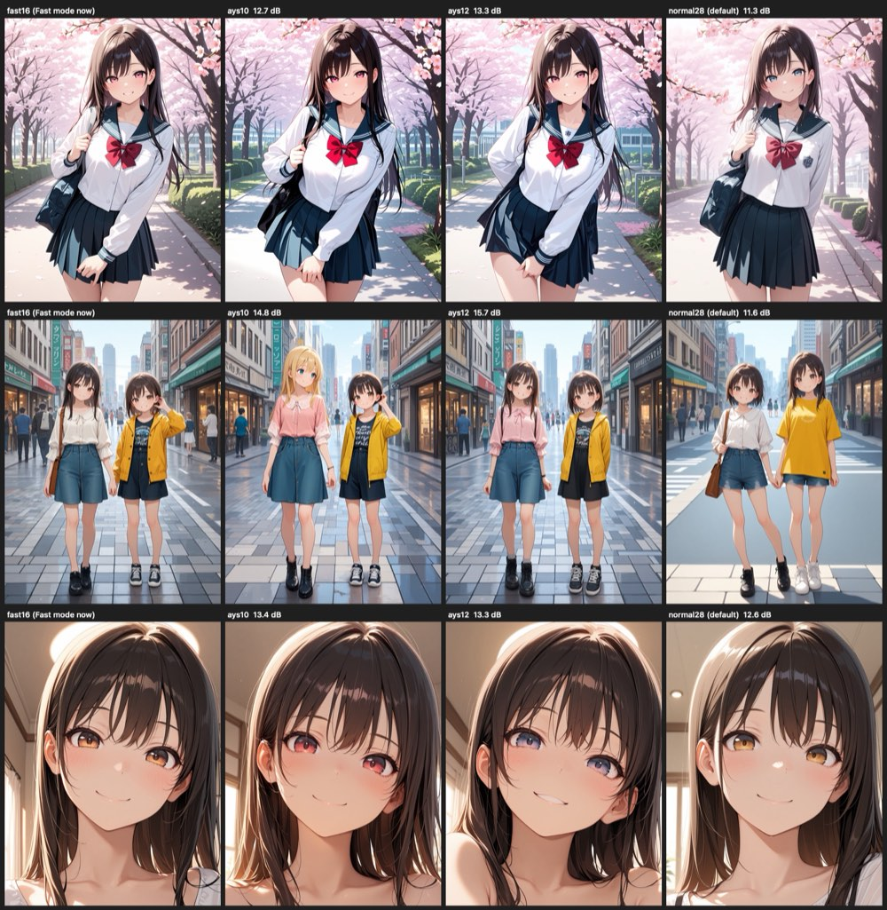
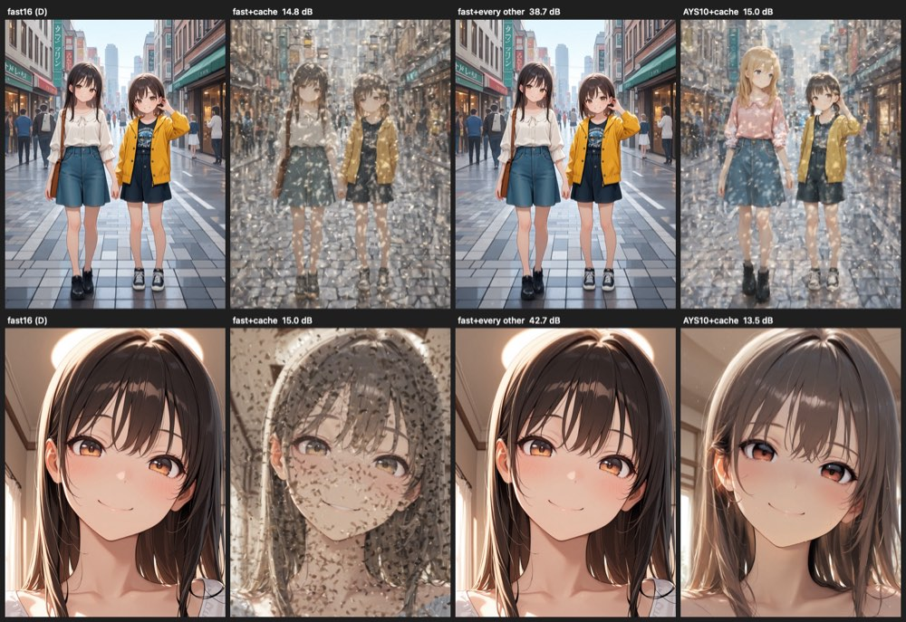
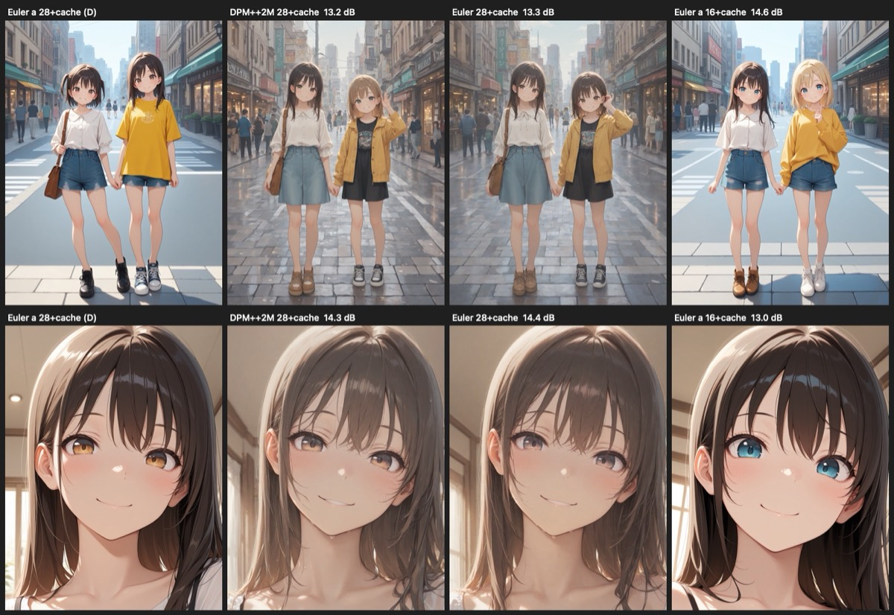

# Performance notes

What makes WAI Gen fast, what was measured, and what was tried and dropped. All numbers are from one
Apple M5 Max (128 GB), Release builds, unless noted. "Warm" = models already loaded.

## Where the time goes (current)

| Job | Time | Biggest part |
|---|---|---|
| WAI v16, 1024×1344, 28 steps | ~15-17 s | UNet sampling, ~0.6 s/step (MLX) |
| WAI v16 face repair (one face) | ~3 s (was 17.3 s, then ~5 s) | 11 masked steps at 768×768 unless the face is bigger (MLX) |
| WAI v16, 1024×1344 → 1536×2016 hi-res + face repair, in the app, Step cache on | **31.6 s** | UNet sampling |
| WAI-ANIMA, 1024×1344 → 1536×2016 hi-res + face repair, in the app, Step cache on | **76 s** (157 s before round 4, 750 s originally) | the Anima model in MLX: 1.36 s/step at 1024×1344 |
| WAI-ANIMA face repair (one face) | ~5-9 s (was ~16 s) | 10 masked steps at 768×768 |

## Round 1: engines (2026-11-19)

### SDXL (WAI-illustrious) in MLX instead of ComfyUI / stable-diffusion.cpp

WAI v16, 832×1216, 28 steps:

| Engine | Time |
|---|---|
| **MLX (WaiMLX, this app)** | **~12 s** |
| ComfyUI (PyTorch MPS) | 15.6 s |
| stable-diffusion.cpp (Metal) | 37.7 s |

The SDXL code is Apple's mlx-swift-examples StableDiffusion, with ComfyUI-style k-diffusion sampling, prompt
weighting and single-file checkpoint loading added. The cond/uncond passes run as one batch of 2, attention
is MLX's fused `scaledDotProductAttention`, and MLX 0.31 uses the M5's neural accelerators for matrix math.

The one fix that mattered: the VAE's middle attention originally built the full [HW × HW] score matrix
(~5 GB at 1248×1824), which pushed the second generation into swap (137 s). Fused attention, a bf16 VAE and
`Memory.cacheLimit = 2 GB` brought VAE decode from 7.6 s to 0.6 s and made repeated runs stable.

### WAI-ANIMA's VAE in MLX (`QwenImageVAE.swift`, `patches/stable-diffusion.cpp.patch`)

stable-diffusion.cpp runs the Qwen-Image (Wan 2.1) VAE through ggml's 3D convolutions, which are very slow on
Metal at these sizes:

| | stable-diffusion.cpp | MLX |
|---|---|---|
| decode 1024×1344 | ~45 s | **0.27 s** |
| decode 1536×2016 | ~135 s | **0.68 s** |
| encode 1536×2016 | ~85 s | **0.59 s** |

- For one frame the causal 3D VAE is exactly a 2D VAE (only the last temporal slice of each 3×3×3 kernel sees
  the image; `time_conv` is skipped on the first frame), so it runs as a plain 2D network.
- A 61-line patch adds `sd_set_vae_hook()` to stable-diffusion.cpp: every single-image VAE encode/decode of a
  context (txt2img, img2img, hi-res, face repair) goes to the app. The latent mean/std normalisation stays
  in stable-diffusion.cpp.
- Checked: encode → decode round trip 44.5-45 dB PSNR; a full txt2img where only the VAE differs is 53.9 dB
  from stable-diffusion.cpp's image; img2img 38.6 dB (one sampling step amplifies tiny differences).
- **Tried and dropped:** stable-diffusion.cpp's `vae_tiling` (154 tiles × 3.3 s, far slower) and
  `vae_conv_direct` (281 s vs 250 s for a 1-step img2img at 1536×2016).

### ESRGAN upscaler in MLX (`RealESRGAN.swift`, `TorchCheckpoint.swift`)

RealESRGAN_x4plus_anime_6B, 1024×1344 → 4096×5376: **1.97 s** in MLX vs 27.5 s in stable-diffusion.cpp
(60.6 dB PSNR between the two). This is the "upscaling" step of every hi-res image. `.pth` files are read by a
loader that implements only the pickle opcodes of a tensor `state_dict` and refuses any other callable (a
booby-trapped file calling `os.system` is rejected and nothing runs).

For WAI-ANIMA the app now runs the hi-res fix itself (base pass → MLX ESRGAN → img2img at the new size) instead
of stable-diffusion.cpp's built-in hi-res, so the upscaler and both VAE passes run in MLX.

**WAI-ANIMA, 1024×1344 → 1536×2016 with hi-res and face repair: 750 s → 346 s; face repair 110 s → 27 s.**

### Keeping models loaded

- The selected image model, the upscaler and the face-repair helpers load in the background when the app
  opens and when another model is picked, so the first image doesn't wait. Loading always yields to a waiting
  generation (each load step is queued behind it).
- They are freed after 5 minutes without generating (configurable) and reload on return.
- Optional: keep every image model loaded for instant switching. Measured footprint with WAI v16, v12 and
  WAI-ANIMA plus face repair loaded: **14 GB** (`footprint`).
- A cold WAI v16 start was only ~3.5 s slower than a warm one (macOS keeps the file cached), so converting
  checkpoints to a faster-loading format isn't worth it.

### Not speed, but found while measuring

Quitting after stable-diffusion.cpp had been used always crashed ("quit unexpectedly"): ggml's Metal backend
asserts in a C++ static destructor at `exit()` that every GPU buffer was freed. The app now frees all models
on `willTerminate`; the CLI leaves through `_exit`.

## Round 2 (2026-11-19 evening)

Ordered by effort: trivial and small changes first, then medium, then large.

### Trivial: 15 hi-res steps instead of 20 (all presets)

- WAI v16, same seed, 1024×1344 → 1536×2016, denoise 0.4: 20, 15 and 12 hi-res steps look the same at full size
  (12 loses a little texture in hair highlights). About 8 s saved per hi-res image.

  
- WAI-ANIMA, same seed, 1.5× of a 1024×1344 image: 20 and 15 steps are indistinguishable; **214.7 s → 174.9 s**.

  
- All presets now use 15; saved settings that still had the old default 20 are migrated once.

### Small changes

| Change | Measured | Kept? |
|---|---|---|
| `MLX.compile` on the UNet call (model passed as state, so LoRA updates are seen) | UNet step 0.628 → 0.609 s (batch 1), 0.571 → 0.538 s (batch 2) at 1024×1344; full image 17.23 → 16.95 s; **bit-identical output** | **yes** |
| WAI-ANIMA weights as `q8_0` (stable-diffusion.cpp `wtype`) | 2.72 → 2.65 s/step (−2.6 %), same 29 s total for 10 steps, output 30.8 dB from the original | no |
| Caching the text encoding between images | the MLX text encode takes 0.04 s | no (nothing to gain) |
| Generating "Images: 2" as one batch | UNet 0.609 → 0.538 s per image per step (−12 %), only for multi-image runs | not yet (would touch every stage: hi-res, face repair, previews) |

Notes:
- stable-diffusion.cpp's fast INT8 path (Metal "TensorOps", the M5's int8 units) is only used for ComfyUI-style
  pre-quantised `int8_tensorwise` safetensors, not for `wtype=q8_0`. Converting WAI-ANIMA to that format wasn't
  pursued because the large step below replaces stable-diffusion.cpp for WAI-ANIMA anyway.
- The benchmark lives in the CLI: `waigen-cli -m <checkpoint> -p x --bench-unet 1024x1344`.

### Medium: face repair for WAI v16 / v12 in MLX

Face repair used a second stable-diffusion.cpp context with the same SDXL checkpoint (~7 GB, ~20 s to load)
and took **17.3 s** warm per image with one face, longer than generating the image (16.4 s).

Now stable-diffusion.cpp only runs the YOLOv8 face detector (new `sd_adetailer_detect()` in
`patches/stable-diffusion.cpp.patch`, ~0.15-0.35 s), and the MLX engine that made the image repaints the faces.
`FaceRepair.swift` ports stable-diffusion.cpp's detailer step by step so the result matches:

- box → `dilate 4` (−1/+2 px) → 32 px padding → square crop around the centre → bilinear resize to 1024×1024;
- masked img2img at strength 0.4: the last `steps × strength` steps of the job's schedule, and after every step
  the prediction outside the mask is replaced by the original latent (`denoised·m + init·(1−m)`, mask
  downsampled nearest-max to latent size), exactly like stable-diffusion.cpp's denoise mask;
- paste back through a Gaussian-feathered mask (σ = 4, radius 10, edges clamped), bilinear resampling at
  half-pixel centres, as `composite_crop` does.

**17.3 s → 6.0 s per image with a face** (detection included), visually equivalent results, and no second copy of the checkpoint in memory.

WAI-ANIMA keeps stable-diffusion.cpp's
own ADetailer (its repaint already uses the MLX VAE).

### Large: WAI-ANIMA's diffusion model in MLX (`AnimaDiT.swift`)

The Anima model (a Cosmos-Predict2-style DiT: 28 blocks, 2048 wide, 16 heads, plus a 6-block LLM adapter that
turns Qwen3-0.6B states into the context) is ported line by line from stable-diffusion.cpp's `anima.hpp`:
padding-mask channel and 2×2 patchify, `[cos | sin]` timestep embedding, AdaLN-Zero modulation
(`LN(x)·(1+scale)+shift`, gates), per-head RMS-normed q/k, rotate-half RoPE over (0, row, col) with 44/42/42
dims and NTK-scaled θ for rows and columns, tanh-GELU MLPs, `(ph pw c)` unpatchify.

stable-diffusion.cpp still does everything around it: Qwen3 text encoding, the sampler and CFG, the progress
and preview callbacks, face repair. The patch adds `sd_set_diffusion_hook()`: when set, Anima's forward pass
calls the app with the latent, timestep, text states and adapter tokens instead of running its ggml graph
(jobs with WAI-ANIMA LoRAs switch the hook off, because the LoRAs are applied inside stable-diffusion.cpp's model).
stable-diffusion.cpp loads weights lazily, so with the hook it never loads its own copy of the model.

| WAI-ANIMA, 1024×1344, 10 steps, same seed | stable-diffusion.cpp model | MLX model |
|---|---|---|
| per step | 2.72 s | **1.36 s** |
| total | 29.1 s | **14.0 s** |

The two images agree to 32.3 dB PSNR (bf16 rounding over 28 blocks × 10 steps; a wrong port gives ~10 dB)
and look the same:

**In the app**, WAI-ANIMA 1024×1344 → 1536×2016 with hi-res (15 steps, MLX ESRGAN) and face repair, including
the cold model load: **156.8 s** (face repair 22.4 s), memory footprint 6.7 GB. The same job was 346 s this
morning and 750 s before the VAE port.

## Round 3 (2026-11-20)

Same order: trivial, small, medium. Everything measured; what didn't pay off was dropped.

### Trivial: Fast mode (opt-in)

A sampler that converges in fewer steps, as a switch in the inspector (off by default, because the picture
changes: Euler a re-injects noise every step, the fast samplers don't). Same seed, 1024×1344:

| Model | Normal | Fast | Look |
|---|---|---|---|
| WAI v16 | Euler a, 28 steps: 14.8 s | **DPM++ 2M Karras, 16 steps: 10.1 s (−32 %)** | clean; 16 steps as good as 20 |
| WAI-ANIMA | Euler a, 25 steps: 35.4 s | **Euler, 16 steps: 25.4 s (−28 %)** | clean; DPM++ 2M at 16 steps left blotchy texture on this flow model |

### Small changes

| Change | Measured | Kept? |
|---|---|---|
| Caching the LLM adapter output across steps (WAI-ANIMA) | the adapter is 4.5 ms of a ~700 ms forward pass (0.6 %) | no |
| `MLX.compile` on the MLX Anima forward pass | −3.5 % per pass once traced (0.704 → 0.679 s), but cond and uncond have different text lengths, so every image traces it twice (and again for hi-res): a 10-step image went 13.1 → 13.8 s. Bit-identical output | opt-in only (`WAIGEN_COMPILE=1`) |
| Quantized Anima linears in MLX | bf16 0.784 s per pass; 8-bit affine 0.812 s; mxfp8 0.883 s; 4-bit 0.784 s (and lower quality). With 5 376 image tokens the GEMMs are compute-bound, bf16 is the fast path | no |

### Medium

| Change | Measured | Kept? |
|---|---|---|
| Both CFG passes of a WAI-ANIMA step in one MLX call (needs another sd.cpp patch) | batch 2 vs batch 1 per sample: 0.752/0.737 s vs 0.787/0.708 s, no consistent gain: the GPU is already saturated at batch 1 | no |
| **LoRAs on the MLX Anima model** | see below | **yes** |
| "Images: 2+" as one batch (WAI v16/v12) | −12 % on the base pass only; with hi-res and face repair (where most of the time goes) about 2-5 % per image, for multi-image runs only, while every stage (hi-res, face repair, previews, per-seed noise) would need batching | no |

**LoRAs on the MLX Anima model.** WAI-ANIMA jobs with LoRAs used to fall back to stable-diffusion.cpp's model
(2.7 s/step). `AnimaDiT.setLoRAs` now merges them into the MLX weights (`W += strength · alpha/rank · up·down`, the
originals kept to undo it) with the key formats stable-diffusion.cpp accepts (kohya `lora_down/lora_up/alpha`, PEFT
`lora_A/lora_B`, `lora_unet_` underscores, `diffusion_model.`/`transformer.`/`net.` prefixes). A LoRA it can't fully
map (LoHa, LoKr) still goes to stable-diffusion.cpp's model. Checked with a synthetic rank-8 LoRA on 36 layers,
same seed, 10 steps:

- MLX vs stable-diffusion.cpp, both with the LoRA: **37.6 dB** (they agree);
- MLX with vs without the LoRA: 21.4 dB (the LoRA really changes the image);
- 14.6 s vs 25.6 s for the image (1.49 vs 2.45 s/step).

The SDXL path was also checked with a real character LoRA (kohya, rank 32, text encoders + UNet): 1 056 layers
applied, 0 unmatched, and the MLX face repair keeps the LoRA.

## Round 4 (2026-11-20)

Same order. Most of the remaining time is the models' own compute, so this round is about running them
less often: skipping steps that barely change the image, and repainting faces at a smaller size.

Note on the numbers: the Mac was in use during part of this round, so the absolute times drift (the same
uncached WAI-ANIMA image took 33.5 s, then 43-50 s). Every comparison below is between runs made back to
back; the number of skipped model calls doesn't depend on load.

### Small: stable-diffusion.cpp's step cache for WAI-ANIMA

stable-diffusion.cpp has step caches built in (`cache.mode`). The ones that work per step (`easycache`,
`spectrum`) skip whole model calls, so they also work with the MLX Anima model behind the diffusion hook;
the block-level ones (`dbcache`, `taylorseer`, `cache_dit`) need stable-diffusion.cpp's own model and skipped
nothing. `SDCppParameters.stepCache` / `--cache mode[:key=value,...]` pass it through.

WAI-ANIMA, 1024×1344, Euler a, 25 steps, same seed:

| Setting | Model calls skipped | Time (back to back) | vs. no cache |
|---|---|---|---|
| none | 0 | 43.2 s / 45.1 s | |
| `easycache` (default threshold 0.2), 0.3, `taylorseer` | 0 | same or slower | identical image |
| **`easycache`, `reuse_threshold` 0.5** | **8 / 25** | **29.3 s / 33.5 s (−26 to −32 %)** | 21.0 dB, looks the same |
| `easycache` 0.7 / 1.0 | 9 / 25 | 31.2 s / 26.3 s | 18.2 dB, small details move |
| `spectrum` (defaults) | not logged | 20.9 s (quiet Mac, vs 33.5 s) | 16.4 dB, **hazy, low contrast** |
| `spectrum`, 6 warm-up steps, flex 0 / 0.25 | 8-9 | 26.5 / 24.7 s (vs 33.5 s) | 18.0-18.2 dB, still flatter |

EasyCache (the rule: between two steps the model's output moves roughly in proportion to its input, at a rate
measured on the steps that ran; while the predicted relative change since the last computed step stays under
the threshold, reuse the last output's offset from its input) at 0.5 is the one kept.

### Medium: the same step cache for WAI v16 (MLX)

`StepCache` in `Sampling.swift` ports that EasyCache rule to the MLX sampler: it sits around the UNet call in
`WaiSDXL.denoiser` (input = the scaled latent, output = the CFG pair of eps predictions), for the base pass,
the hi-res pass and the face repaint, each with its own cache. Off, the graph is exactly the uncached one.

WAI v16, 1024×1344, Euler a, 28 steps, same seed:

| Threshold | Skipped | Base pass |
|---|---|---|
| none | 0 | 20.2-21.5 s |
| 0.1 / 0.2 / 0.3 | 0 | (Euler a re-injects noise every step, so the eps output keeps moving) |
| **0.5** | **8 / 28** | **15.0 s (−28 %)**, nearly the same image |
| 0.7 | 10 / 28 | 12.5 s, the background changes more |

Full job (base + 1.5× hi-res with RealESRGAN + face repair), back to back: **57.7 s → 42.5 s (−26 %)**, 13 model
calls skipped. At full size the face is as sharp; distant buildings are a little softer. A denoised-prediction
variant (reuse x0 instead of eps) was sketched for Euler a but not needed once 0.5 worked.

In the app this is **Step cache** (inspector ▸ Image, off by default because the picture changes a little), using
0.5 for both models; images made with it say `Step cache: EasyCache` in their parameters and "Use Prompt and
Settings" restores it. In the app with it on: WAI v16 full job 31.6 s, WAI-ANIMA full job 76 s.

### Small: cheaper WAI-ANIMA face repair

stable-diffusion.cpp's ADetailer repainted each face crop at 1024×1024 (10 masked steps). Same image, one face:

| Repaint | Time | Look |
|---|---|---|
| 1024 px, 10 steps (before) | 15.9 s | |
| **768 px, 10 steps** | **8.7 s (−45 %)** | same at the size the face is pasted back |
| 1024 px, 6 steps (16-step schedule) | 11.2 s | similar here |
| 768 px, 6 steps | 6.2 s | similar here |
| 1024 px + EasyCache 0.5 | 12.1 s (3 / 11 skipped) | same |

Fewer steps looked similar on this face too, but the job's step count is kept so the repair strength means
what it did before. The app now detects the faces first and repaints at **768 px unless a face crop is larger than that**
(close-ups keep 1024 px, so no detail is lost when the crop is pasted back), with the step cache when it's
on: 5.1 s in the app test above. Images without a face skip the pass entirely. (Round 5 removed the second
detection this needed.) WAI v16's MLX face repair kept 1024 px until round 8.

### Small: fp16 instead of bf16 for the MLX Anima model

0.851-0.887 s vs 0.870-0.897 s per pass at 1024×1344 (batch 1, four runs each): within noise, and fp16 risks
overflow in the residual stream. **Not kept** (`--anima-dtype f16` stays in the CLI for testing).

### Not done

A turbo / few-step distilled LoRA for WAI v16 was left out on purpose: it changes WAI's look.

### CLI flags added

`--cache mode[:key=value,...]` (WAI-ANIMA step cache), `--step-cache <threshold>` (WAI v16), `--face-size`,
`--face-steps`, `--face-cache` and `--detail-only <image>` (WAI-ANIMA face repair on its own), `--anima-dtype f16`.

## Round 5 (2026-11-20): the last two parts in MLX

The two pieces of WAI-ANIMA still in stable-diffusion.cpp were small, but MLX runs both faster, so they moved.
Measured with `WAIGEN_SDCPP_LOG=info`, which prints stable-diffusion.cpp's own stage timings.

### Face detector (`YOLOFaceDetector.swift`), both models

YOLOv8 (`face_yolov8m`, batch norms already folded) ported from stable-diffusion.cpp's `yolov8.h`, with the same
letterbox (640 px, bilinear at half-pixel centres, grey 114 padding), DFL box decoding, confidence filter and
per-class NMS as its `detailer.cpp`. Six test images (one to three faces):

| | stable-diffusion.cpp | MLX (fp16) |
|---|---|---|
| Boxes | | same faces, same confidences, coordinates within 0.4 px |
| Detection, warm | 0.068 s (0.27 s inside its ADetailer) | **0.011 s** |
| Loading the detector | 0.20 s | 0.02 s |

With it, WAI-ANIMA's face repair no longer goes through stable-diffusion.cpp's ADetailer: the MLX detector finds
the faces, `FaceRepairGeometry` (the ADetailer geometry already ported for WAI v16) crops and blends them in Swift
(0.010 s), and each crop is repainted by stable-diffusion.cpp's masked img2img (`SDCppParameters.maskImage`, the
same call its ADetailer makes). Same image as before: **52.6 dB** against stable-diffusion.cpp's ADetailer. Per
image with a face that saves ~0.5 s (round 4's size check had added a second detection), and WAI v16 no longer
uses stable-diffusion.cpp at all.

### WAI-ANIMA's text encoder (`Qwen3TextEncoder.swift`)

Qwen3-0.6B in MLX (28 layers, grouped KV heads 16/8, RMSNorm on q and k, NEOX RoPE base 1e6, causal, final norm),
behind a fourth hook in the patch (`sd_set_text_encoder_hook`): stable-diffusion.cpp still tokenizes (Qwen and T5
tokenizers, prompt weights) and hands the token ids over. While the hook is set it never loads its own copy of
the encoder (it used to load it, 1.2 GB, on the first image).

My round-4 note said the encoder took 0.26 s per prompt; measured properly (five different prompts in one process):

| | stable-diffusion.cpp | MLX bf16 | MLX float32 |
|---|---|---|---|
| First prompt after loading | 0.33 s (0.20 s of it loading the weights) | **0.08 s** | 0.08 s |
| Each new prompt after that | 0.01-0.02 s | **0.01 s** | 0.02 s |
| Output vs stable-diffusion.cpp | | cosine 0.99986 | cosine 0.9999997 |

bf16 weights with float32 math matched exactly too but took 0.04 s (the weights get converted on every call).
The images look the same with all three: Euler a turns even float32's 0.08 % difference into ~27 dB, the same as
bf16's, and the side-by-side shows the same picture, so bf16 (fastest, 1.2 GB) is kept. A job with a LoRA the MLX
models can't fully take (LoHa / LoKr, or text-encoder layers) still runs entirely in stable-diffusion.cpp.

So the gain is ~0.25 s on the first image after the model loads and ~0.01 s per new prompt after that.

## Round 6 (2026-11-20): stable-diffusion.cpp removed

What stable-diffusion.cpp still did for WAI-ANIMA cost 0.10 s of 32 s (see below), so this round isn't about
speed: it ports the rest so the app has no C++ inference library left. `WaiAnima.swift` reimplements the
pipeline and `AnimaText.swift` the prompt handling, line by line from stable-diffusion.cpp, and each part was
checked against it (with the sd.cpp hooks as probes) before the dependency was dropped:

| Part | Check | Result |
|---|---|---|
| `(tag:1.2)` parser, Qwen2 BPE and T5 unigram tokenizers | token ids and weights for 14 prompts (weights, escapes, BREAK, special tokens, accents, CJK, emoji, extra spaces) | **identical** |
| Philox noise generator | 16 384 values for one seed | 16 261 bit-identical, the rest within 7e-7 (its float math is vectorised differently) |
| discrete-flow schedule (shift 3), timesteps | sigmas and the timesteps the model receives | identical |
| CFG, model call, Wan latent normalisation, decode | a 1-step image | **bit-identical** |
| Euler, 12 steps | full image | 40.6 dB (the 1e-7 noise differences grow over the steps) |
| Euler a, 12 steps | full image | 28.9 dB, the same picture (ancestral noise amplifies tiny differences) |
| masked img2img (face repair) | same face, 1024 px | 49.4 dB |
| EasyCache 0.5 | steps skipped, 25-step image | 8 / 25 in both, same time |
| speed | 12 steps at 1024×1344, back to back | 14.9-17.0 s vs 16.8-17.2 s (load noise) |

Running both CFG passes as one MLX graph was ~10 % slower than evaluating them one after the other, so they're
evaluated separately. WaiAnima keeps MLX's buffer cache at 2 GB like the SDXL engine: a hi-res job peaked at 34 GB
with an unbounded cache and **16 GB** with it, at the same speed (71.9 vs 73.1 s, 78.2 vs 79.1 s).

LoRAs: the MLX model now also merges **LoHa** (`hada_*`) and **LoKr** (`lokr_*`) with stable-diffusion.cpp's scale
rules. Checked with synthetic files: a LoHa whose second factor is all ones and a 1x1 LoKr give images
bit-identical to the equivalent plain LoRA. (stable-diffusion.cpp itself crashed on the LoKr test file,
`GGML_ASSERT(ggml_can_mul_mat)`, and applied the LoHa more weakly.) Text-encoder layers in a WAI-ANIMA LoRA are
not applied (none of the WAI-ANIMA LoRAs checked have them).

Also gone with it: the 978 MB vendored checkout, the CMake build step, the patch with its four hooks, the
ggml exit-time assert workaround. The app is 22 MB instead of 61 MB. Upscaler models the MLX ESRGAN port can't
run (e.g. `4x-UltraSharpV2`, a DAT transformer) are no longer listed.

In the app (cold, model loading in the background, Step cache off): WAI-ANIMA 1024×1344 → 1536×2016 with
face repair 145 s (154-158 s with stable-diffusion.cpp under similar load); WAI v16 54.5 s including its load.

## Round 7 (2026-11-20): 3×3 convolutions on the M5's neural accelerators

The M5's GPU has a neural accelerator in every core. MLX 0.31 uses them (its "NAX" kernels, macOS 26.2+) for
matrix multiplies, quantized matmuls and attention, so WAI-ANIMA's model and text encoder and the SDXL
attention/linear layers already run on them. MLX's 3×3 `conv2d` doesn't: it uses implicit-GEMM or Winograd
kernels. (The separate 16-core Neural Engine is out of MLX's reach; only Core ML can use it, and on a Max-class
chip it is far slower than the GPU for models this size.)

`waigen-cli --bench-conv` times three ways of running the 3×3 convolutions of the real models and measures
each against a float32 reference (fp16 / bf16 as the models run):

| Layer (batch as run) | conv2d | im2col + 1 matmul | 9 shifted matmuls | error vs float32: conv2d / 9 matmuls |
|---|---|---|---|---|
| SDXL UNet 1024×1344, 320 ch | **1.64 ms** | 3.07 ms | 4.35 ms | 0.0048 (Winograd) / - |
| SDXL UNet 1024×1344, 640 ch | **1.62 ms** | 2.22 ms | 2.90 ms | 0.0050 / 0.00038 |
| SDXL UNet 1024×1344, deepest level 1280 → 1280 | 5.84 ms | 2.14 ms | **1.95 ms (3.0×)** | 0.00014 / 0.00037 |
| same, 2560 → 1280 / 1920 → 1280 | 11.68 / 8.78 ms | 4.62 / 3.28 ms | **3.46 / 2.90 ms (3.4× / 3.0×)** | 0.00014 / 0.00037 |
| hi-res 1536×2016 deepest level, 1280 / 2560 in | 5.65 / 12.38 ms | 4.37 / 9.12 ms (**inf** errors at 2560) | **4.44 / 7.77 ms (1.3× / 1.6×)** | 0.0051 / 0.00038 |
| SDXL / Qwen-Image VAE decode, 128-512 ch | **4.4-13.8 ms** | 0.3-0.5× | 0.2-0.3× | 0.038 (Winograd, bf16) |
| Qwen-Image VAE, 96 ch at full size | 26.9 ms | 21.9 ms (1.23×; the 1536×2016 size crashed the GPU) | 37.5 ms | |
| ESRGAN 688² tiles | **3-9 ms** | 0.4-0.8× | 0.3-0.5× | |

So MLX's conv2d stays the right choice almost everywhere, except at the UNet's deepest level (few positions,
many channels), where nine shifted matmuls on the neural accelerators are 3× faster at the base size and
1.3-1.6× at the hi-res size, and also more precise than the Winograd kernel conv2d uses at larger sizes. The
single big im2col matmul gave wrong values (inf) for the hi-res 2560-channel layer and crashed at the largest
VAE size (a 9× copy over 2^31 elements), so it isn't used.

`UNet.swift` now runs ResNet 3×3 convolutions with ≥ 1280 input channels at ≤ 4096 positions as nine matmuls
(13 convolutions per step; `WAIGEN_CONV_MATMUL=0` turns it off). WAI v16, 1024×1344, 28 steps, alternating
off / on (the Mac warming up between runs, which works against "on"): 16.22 / 16.48 → **14.46 / 14.90 s**,
17.00 / 17.61 → **16.10 / 16.42 s**, 19.02 / 19.72 → **18.03 / 18.01 s**: **6-10 % per image**. Same picture
(27.7 dB, Euler a amplifying the different rounding).

## Round 8 (2026-11-22): the 768 px face rule for WAI v16 too

Round 4's rule (repaint at 768 px unless a face crop is bigger) now applies to WAI v16's MLX face repair as well.
`waigen-cli --detail-only <image> --face-size 1024,768 --repeat 3` repaints the same faces at both sizes, same seed.
Three WAI v16 images at 1536×2016 (1.5× hi-res with RealESRGAN, Step cache on), strength 0.4, 11 masked steps,
the face pass without the step cache:

| Image | Faces (largest crop) | 1024 px | 768 px |
|---|---|---|---|
| cowboy shot | 1 (537 px) | 4.33 / 4.53 / 4.84 s | **2.87 / 2.90 / 2.92 s (−36 %)** |
| same, 768 px run first | | 5.14 / 5.13 / 5.20 s | 2.92 / 2.95 / 3.02 s |
| two girls, full body | 2 (335 px) | 9.82 / 9.90 / 9.99 s | **5.86 / 5.78 / 5.82 s (−41 %)** |
| close-up | 1 (1447 px) | 4.87-5.06 s | (the rule keeps 1024 px) |

The faces look the same at 100 %: 768 vs 1024 px is 23.0 / 25.7 dB over the repainted area, as far apart as each is
from the face before repair (Euler a noise, not lost detail). The crop is pasted back at ≤ 768 px, so a 768 px
repaint is still downscaled. In the app, the cowboy shot's face pass took 3.5 s with detection. That's ~1.7 s per
image with one face and ~4 s with two, of a ~30 s image.

## Round 9 (2026-11-22): less classifier-free guidance in the hi-res pass (WAI v16)

Every guided step runs the UNet twice (prompt and negative, as one batch of 2). Kynkäänniemi et al. (NeurIPS 2024,
"Applying Guidance in a Limited Interval") and Adaptive Guidance (Castillo et al., AAAI 2025) found guidance largely
unnecessary at low noise. WAI v16's hi-res pass (denoise 0.4, 15 steps) only covers σ 1.12 → 0.03, the low-noise
end, so it was the obvious place to try. `WaiSDXL` got `guidanceSigmaMin/Max`, `hiresGuidance` and
`hiresGuidanceEvery` (all off by default: the original graph); the CLI flags are `--guidance-interval lo,hi`,
`--hires-no-guidance` and `--hires-guidance-every 2`. With any of them the step cache works on the guided
prediction instead of the CFG pair.

Three seeds, 1024×1344 → 1.5× hi-res with RealESRGAN, Step cache on, back to back (the Mac got slower as the runs
went on, so compare within a seed):

| Variant | Guided steps (base / hi-res) | Seed 101 | 202 | 303 | Look |
|---|---|---|---|---|---|
| now | 28 / 15 | 27.8 s | 31.1 s | 37.2 s | |
| V1: no guidance in hi-res | 28 / 0 | **23.4 s** | **24.3 s** | **29.3 s** | same picture (27-29 dB), but at 100 % blush hatching and iris highlights soften |
| V2: none below σ 0.5 | 23 / 8 | 28.6 s | 29.9 s | 33.5 s | small details change (white sneakers) |
| V3: interval (0.28, 5.42] | 20 / 12 | 28.7 s | 33.9 s | 33.7 s | **different images** (outfits, hair colour): WAI needs early guidance to follow the prompt |

V2 and V3 paid for extra `MLX.compile` traces (batch 1 next to batch 2) in each fresh CLI process.

**Every other step (kept, opt-in).** On every second guided call the hi-res pass runs the pair, keeps the
guidance direction `eps_c − eps_u`, and on the calls between runs the UNet once on the prompt and adds the last
direction: `eps_c + (cfg − 1)·(eps_c − eps_u)_last` (CFG caching, as in FasterCache). Measured warm (a warm-up
image of another seed first in the same process, as the app keeps its traces):

| Seed | now | every other step | V1 |
|---|---|---|---|
| 101 | 31.0 s (hi-res 18.6 s) | **28.2 s (14.9 s), −9 %** | 26.2 s (12.6 s) |
| 202 | 39.9 s (24.1 s) | **35.2 s (19.2 s), −12 %** | 29.8 s (13.8 s) |
| 303 | 37.3 s (22.1 s) | **32.6 s (17.6 s), −13 %** | 28.3 s (13.3 s) |

Every other step stays 33-38 dB from the current image and keeps the fine linework V1 loses (the same image run
twice: 99 dB, so the pipeline is deterministic). The app's image with the setting on is bit-identical to the CLI's.

In the app this is **Faster hi-res guidance** (inspector ▸ Hi-res fix, WAI v16 only, off by default like Fast mode
and Step cache); it also applies to the gallery's Upscale with detail pass. Images made with it say
`Hires guidance: every 2 steps` in their parameters and "Use Prompt and Settings" restores it. WAI-ANIMA wasn't
tried yet (its CFG passes run separately, so the same trick would also save one pass per reused step).

## Round 10 (2026-11-22, overnight): everything left on the list, measured

Three seeds (the same prompts as round 9), WAI v16 1024×1344 → 1.5× hi-res with RealESRGAN, WAI-ANIMA its preset
(25 steps, CFG 4.5). Every configuration ran twice in one process (a warm-up image of seed − 1, then the timed one),
so kernels and compile traces are warm as in the app. Compare within a row: the Mac's speed drifted over the night.

### Guidance reuse in the hi-res pass

| | full guidance | every 2nd step | every 3rd step |
|---|---|---|---|
| WAI v16, Step cache on | 33.7 / 37.0 / 37.6 s | 30.8 / 33.3 / 33.3 s (−9 to −11 %), 33-38 dB | 31.0 / 32.4 / 32.4 s, 31-35 dB |
| WAI-ANIMA, Step cache on | 84-88 s (hi-res 56-57 s) | 65-67 s (36 s), **−23 %**, 26-31 dB | 70-72 s (41 s), **−18 %**, 32-36 dB |
| WAI-ANIMA, Step cache off | 131 s (hi-res 89 s) | 110 s (68 s), −16 %, 33-37 dB | hi-res 78.5 → 62.3 s (−21 %, measured later), 31-35 dB |

On WAI v16 every 3rd step saves only 0.2-1 s more than every 2nd (the step cache already skips many hi-res
steps). On WAI-ANIMA with the step cache, every 2nd step deepens shadows a little; every 3rd step looks the same.

The first WAI-ANIMA attempt gave oversaturated, pink images (15-17 dB): Anima's EasyCache keeps separate offsets
for the prompt and negative passes, and on reused steps only the prompt's was refreshed, so on the next skipped
step `cond − uncond` mixed outputs from different steps and carried the step's movement (× (cfg − 1) = 3.5). Now a
step the cache skips keeps the last real guidance direction. (WAI v16's StepCache wraps the guided prediction, so
it never had this.)

### Dropped

| Change | Measured | Look |
|---|---|---|
| Guidance reuse in the base pass below σ 1.0 / 2.0 (with every 2nd hi-res step) | −0.2 to −0.6 s (1-2 %) | 20-24 dB: twin tails lost, sneakers and gaze change |
| ToDo token downsampling (Smith et al., IJCAI 2024; 2×2-pooled keys/values) from 8192 positions (hi-res pass only) | −2.3 s (−6 %) | 25-30 dB, blush hatching and iris soften at 100 % |
| same from 4096 positions (base pass too) | −3.3 to −4.3 s (−9 to −11 %) | 18 dB: washed out, content changes |
| mlx-swift 0.33.0 (MLX 0.32.4) instead of 0.31.6 | UNet step within noise; full image −1.5 to −2.5 % (WAI v16), −1.3 % (WAI-ANIMA) | same pictures (22-25 dB, rounding through Euler a); builds with one change (`compiledUNet` loses `@Sendable`) |

### Align Your Steps for Fast mode (WAI v16, no Step cache)

| normal, Euler a 28 | Fast mode now, DPM++ 2M Karras 16 | AYS, DPM++ 2M 10 | AYS, DPM++ 2M 12 |
|---|---|---|---|
| 48.2-50.7 s | 40.9-43.4 s | **37.2-39.5 s** | 38.4-41.0 s |

`SchedulerKind.ays` is NVIDIA's SDXL schedule (log-linear interpolated for other step counts, as ComfyUI's
AlignYourStepsScheduler). At 10 steps the images are as clean as Fast mode's at 16, 2-4 s faster; details and
colours differ as with any sampler change (hair and eye colours the prompt doesn't fix).

### Everything on, and a bug it found

| | defaults | Step cache | Fast mode | Fast mode + Step cache + every 2nd hi-res step |
|---|---|---|---|---|
| WAI v16 | 47.7-48.0 s | 34.9-35.2 s | 40.5-40.7 s | 20.7-21.5 s, **grainy** |
| WAI-ANIMA | 131 s | | 116 s | 38-40 s, one of three **grainy / photographic** |

Taking the combination apart: Fast mode + every 2nd hi-res step is fine (36-47 dB from Fast mode alone; WAI v16
34.5 s), **Fast mode + Step cache is what breaks**, and it isn't the step count but the sampler:

| Step cache with | model calls skipped (WAI v16, base + hi-res) | image |
|---|---|---|
| Euler a 28 (the tuned case) | 13 of 43 | fine |
| Euler a 16 | 5 | fine |
| DPM++ 2M 28 / Euler 28 | 23-25 | washed out, hazy |
| DPM++ 2M Karras 16 (Fast mode) / AYS 10 | 16 / 12 | grainy |
| WAI-ANIMA Euler 25 | 14-15 (Euler a: 7-8) | hazy, style drifts |

Euler a adds fresh noise every step, so the latent keeps moving and EasyCache's rate estimate stays honest; with
deterministic samplers the input changes smoothly, the predicted change stays under the threshold and about half
the calls are skipped. Versions up to 0.3.3 let Fast mode and Step cache be on together. **Fixed in 0.3.4**: the step
cache only applies with Euler a, and the inspector says when it isn't used.

### In the app

"Faster hi-res guidance" now covers WAI-ANIMA as well, with guidance on every 3rd hi-res step
(`EngineKind.fastHiresGuidanceEvery`: 2 for WAI v16, 3 for WAI-ANIMA). Checked through the app's generator path: a
WAI-ANIMA job with the setting is bit-identical to the CLI's every-3rd-step image. `--hires-guidance-every N` works for both models
in the CLI. The dropped experiments (`--base-guidance-every N,σ`, `--todo N`, `--scheduler ays`) and the MLX 0.33
build stay on the `exp/overnight-speed` and `exp/mlx-0.33` branches.

## Possible next steps

- Everything runs in MLX (round 6). Before that, stable-diffusion.cpp kept WAI-ANIMA's tokenizers, sampler and masked img2img.
  Measured what that costs (`WAIGEN_HOOK_TIMING=1` adds up the time inside the MLX diffusion hook): 1024×1344,
  25 steps, sampling 31.97 s of which 31.87 s is the MLX model, so **0.10 s (0.3 %)** is stable-diffusion.cpp's
  sampler, CFG and data copies. With every hook set it loads none of its own weights (its log lists 5.4 GB it would
  load; a small job peaks at 7.2 GB, 5.6 GB of which are the MLX weights). Porting the rest (two tokenizers, the
  flow sampler, masking, EasyCache) would save at most that 0.1 s; it would only be worth it to drop the C++
  dependency altogether.
- `4x-UltraSharpV2` (in the upscaler folder) is a DAT transformer, not ESRGAN: neither the MLX port nor
  stable-diffusion.cpp can run it ("register upscaler weights failed").
- What remains is mostly the models' own compute. Fewer model calls (Fast mode, Step cache, or both) is the
  remaining lever; they stack, but each changes the picture a little.
